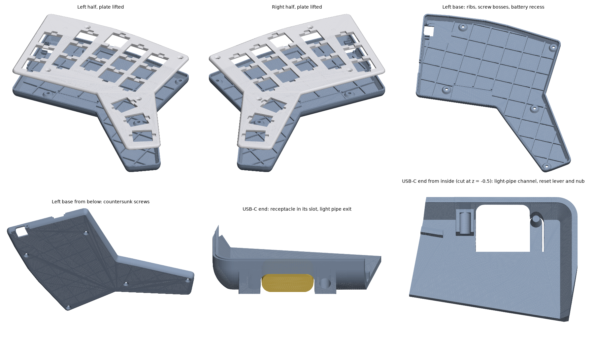
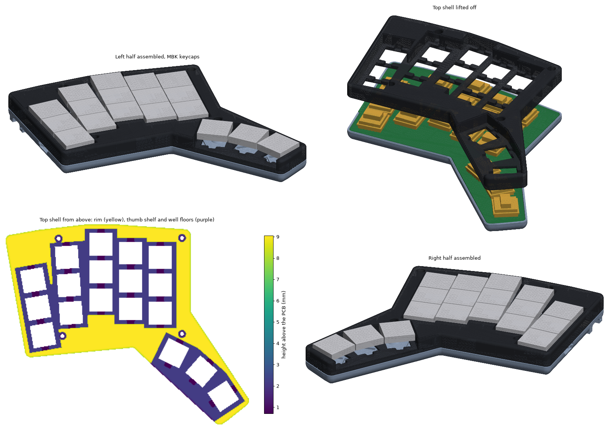
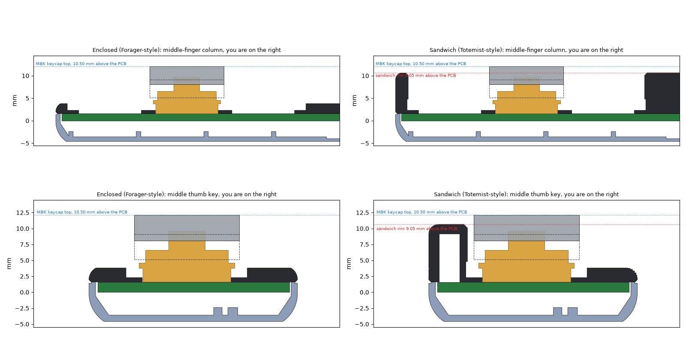

# Cases: Fortemis

Two cases for Fortemis, each in its own folder. Both are built from the routed PCBs in `pcb/` by a
script in `ergogen/tools/`, use the same base, screws, nuts, switches and keycaps, and follow the
Forager (requirement C1): a fully enclosed two-piece case whose top holds the switches.

| | [Enclosed](enclosed/README.md) | [Sandwich](sandwich/README.md) |
|---|---|---|
| Style | Like the Forager: a flat 2.2 mm top plate, switches and keycaps stand on top | Like the Totemist (and GEIST's TOTEM): keycaps sit in wells, the rim comes up to just under their tops (C4) |
| Top | `fortemis_<half>_top.stl`: the plate | `fortemis_<half>_top.stl`: the same plate at the bottom of the wells, plus a rim 9.05 mm above the PCB |
| Base | `fortemis_<half>_base.stl` | The same base (a copy is in the folder) |
| Desk to plate / rim / keycap tops | 8.4 / – / 16.7 mm | 8.4 / 15.3 / 16.7 mm |
| Footprint per half | 147.9 × 122.1 mm | The same |
| Screws per half | 9 × M2×4 countersunk (4 top, 5 bottom) | The same |
| Built by | `ergogen/tools/case.py` | `ergogen/tools/case_sandwich.py` |

Side by side, cut through the middle-finger column and the middle thumb key:

**Which one?** The enclosed case is the Forager exactly, and the keycaps are easy to reach. The
sandwich case keeps all of that and looks and feels like the Totemist: the switches are hidden and
the rim guards the keycaps from the side. The trade-off is that its wells hold sweat on the plate,
where a flat plate lets it run off the edge.

How to print and fit either case: [build guide](../docs/build-guide.md#printing-the-case).
